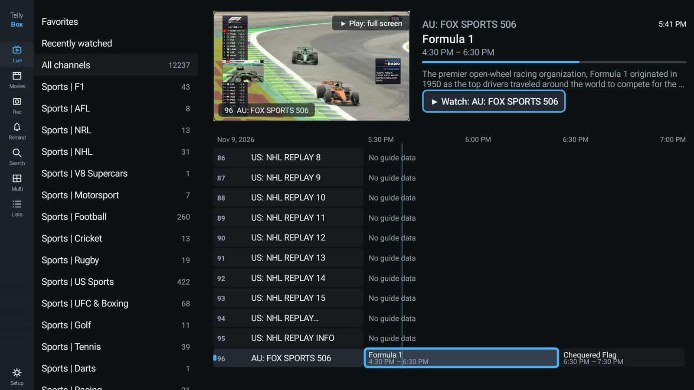
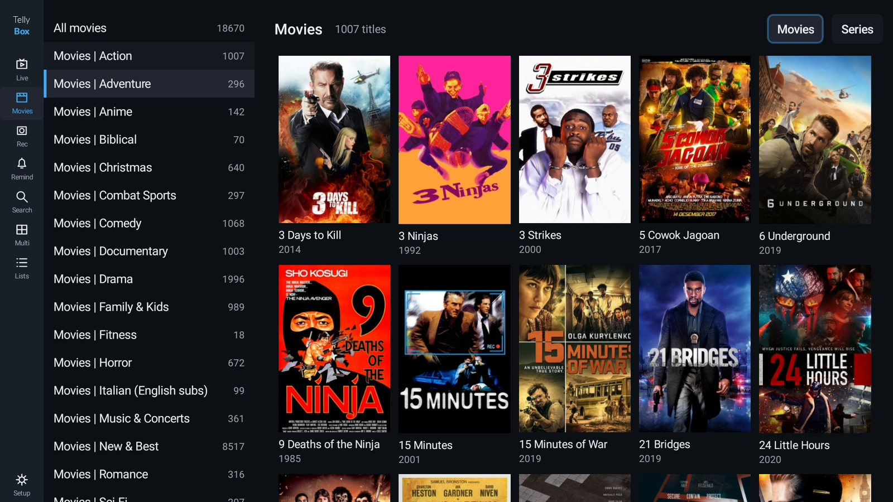
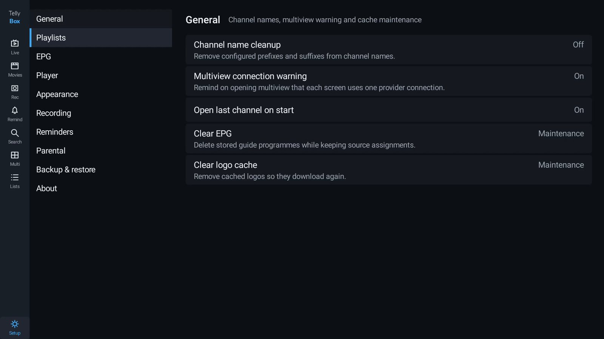

# Tellybox

A free IPTV player for Android TV. Paste your playlist or your Stalker portal and it builds the
channel list, pulls the guide in, and plays the streams. No account, no ads, no subscription, no
tracking.

It doesn't come with any channels. You use your own line, and you're responsible for having the
right to watch what's on it.

**[Download the latest APK](https://github.com/Jonesyj83/tellybox/releases/latest)**  ·  Downloader code **9720603**

Open the Downloader app on your TV, type that number, install. Done.



If your provider gave you a MAC address and a portal URL, that's a Stalker portal, and it's the one
this app handles best. It signs film links the way the portal expects and keeps everything on the
box, so search, favourites and history come back instantly. M3U links, M3U files and Xtream logins
work the same way.

<a href="https://buymeacoffee.com/jonesy"></a>

## What you need

- An Android TV or Google TV device on Android 6.0 or newer
- A playlist: an M3U/M3U8 link or file, an Xtream Codes login, or a Stalker portal MAC
- Optionally, an XMLTV guide link (most playlists advertise one, and Tellybox picks it up
  by itself)

## Install

1. Grab the APK from the [releases page](https://github.com/Jonesyj83/tellybox/releases/latest).
2. Get it onto the TV. Easiest is the Downloader app on the TV with the code above. Or from a
   computer with `adb install -r Tellybox.apk`.
3. Allow installs from unknown sources when the TV asks. Android TV blocks sideloading by
   default, this is the normal prompt for any app that didn't come from the Play Store.
4. Open Tellybox, choose **Add playlist**, and paste your link.

## Features


**Live TV**
- Channel list with groups down the side, a preview window, and now/next information
- Preview first, then OK again for full screen. You can browse to any other channel while
  the preview plays and jump it to full screen without finding it again
- Channel up/down zapping, numeric entry for channel numbers
- HLS, DASH, MPEG-TS and RTMP through Media3/ExoPlayer
- Audio track, subtitle and display mode pickers, plus an audio passthrough option for
  surround sound setups
- Pause and rewind live TV with a scrubbable bar and a jump back to live. The buffer lives on
  the device and you choose how much of it to keep in Settings

**Guide**
- XMLTV import, plain or gzipped, streamed in so a 200 MB guide doesn't run the box out of
  memory
- Guide URL taken from the playlist's `url-tvg` or from an Xtream panel, or attached by hand
- TV guide grid with a time ruler, current-time marker and programme details
- Guide offset setting for providers whose times are wrong

**Catch-up**
- Play past programmes straight from the guide, on channels whose provider supports it
- Works with Xtream timeshift, M3U `catchup-source` templates and Stalker archive links
- Future programmes are refused rather than failing silently

**Movies and series**
- Posters, categories, seasons and episodes from Xtream panels, Stalker portals and M3U VOD
  entries
- Resume where you left off



**Recording**
- Record what you're watching, or schedule from the guide
- Start and end padding, so you don't lose the first or last minute
- Recordings list with playback and delete
- Reminders that pop up before a programme starts

**Multiview**
- Two, three or four live channels on one screen, laid out properly (two side by side,
  three as two-up plus one, four as quarters)
- Sound follows the focused screen; screens can be swapped, enlarged or removed
- Warns about your provider's connection limit, because each screen is one connection

**Comfort**
- Sleep timer: 30, 60, 90, 120 minutes or the end of the current programme
- Option to open the last channel you were watching when the app starts
- Picture-in-picture, and a media session so the TV remote and notification controls work
- Optional background playback

**Playlists and organisation**
- Several playlists at once, each with its own guide
- Favourites, recently watched, search across channels and programmes
- Hide, reorder and rename groups, clean up channel names
- Playlist editing and refresh, on demand or on a schedule

**Parental controls**
- PIN lock, with channels and whole groups blocked

**Backup**
- Export playlists, guide assignments, favourites, watch history, blocked channels, settings
  and the parental PIN to one file, and restore it
- The file goes straight to Downloads with the date in the name, and restoring is all or
  nothing: a bad file is refused before anything changes

**Languages**
- 32 languages, picked in Settings and applied without a restart
- I only speak English, so the rest were done with a translator. If a phrase reads wrong in
  your language, send a corrected `strings.xml` and it will go in

**Escape hatch**
- Send any stream to another player (VLC, MX Player) when ExoPlayer struggles with it

RTMP playback is compiled in but hasn't been tested against a real stream.

What's coming next, and what isn't, is in [ROADMAP.md](ROADMAP.md).

## Remote control

| Key | Channel list | Player |
|---|---|---|
| OK | preview the channel, OK again for full screen | show controls / retry |
| Long-press OK | channel options | options: tracks, record, sleep, multiview, external player |
| Up / Down, CH+ / CH- | move | previous / next channel |
| Back | back to groups, clear search, then exit | back to the list |

Remotes without a Menu key are fully supported. Everything on the Menu is also in the
long-press OK menu, and Record and Sleep have their own buttons on screen.

In multiview the D-pad moves between screens, OK opens the focused screen's options, CH+
and CH- change its channel, and Back returns to the single player with that channel.

## Supported devices

Built against standard Android TV APIs, with no Google Play Services dependency and no
native libraries, so it runs on Shield TV, Chromecast with Google TV, Sony, TCL, Hisense,
Philips, Xiaomi Mi Box, Amazon Fire TV and the various Amlogic boxes.

- Android 6.0 (API 23) and newer
- Works on Fire TV, which has no Play Services: nothing here depends on it
- Phones and tablets are not supported yet. The app requires a TV (leanback) device and the
  layout assumes a large screen

## Known limits

- Recording captures the stream as it arrives. If your provider doesn't allow more than one
  connection, recording while you watch something else will fail, same as any other player
- Whether catch-up works depends entirely on the provider. Plenty don't support it at all
- Very old or unusual providers (some Stalker portals) may need the stream sent to VLC

## Building

Requires JDK 17+ and the Android SDK with compileSdk 36.

```
./gradlew assembleDebug     # app/build/outputs/apk/debug/app-debug.apk
./gradlew test              # parser and logic tests, run on the JVM
```

Install with `adb install -r app/build/outputs/apk/debug/app-debug.apk`.

Release builds read the signing key from `local.properties`, which is not committed:

```
tellybox.storeFile=/path/to/keystore.jks
tellybox.storePassword=...
tellybox.keyAlias=...
tellybox.keyPassword=...
```

Without those entries the release build still runs, just unsigned.

## How it's put together

```
app/src/main/java/com/tellybox/tv/
  data/db/           Room entities and DAOs
  data/parser/       M3U, XMLTV, Xtream Codes and Stalker clients, no Android deps,
                     unit-tested on the JVM
  data/repository/   import and refresh logic tying the parsers to the database
  player/            Media3 player setup and the playback service
  ui/                activities: channel list, guide, VOD, playlists, player, multiview,
                     recordings, settings
```

Favourites and watch history are keyed on a stable per-channel key (provider stream id or
URL) rather than the database row id, so they survive a playlist refresh. Guide programmes
are matched to channels on the `tvg-id` the playlist gives them.

## Settings

Everything lives in one place, and every option does something.



## Questions people ask

**How does this compare to TiviMate?**
It does the same job: playlists, guide, catch-up, recording, multiview, parental controls. The
differences that matter to most people are that Tellybox is free with no premium tier, no
activation and no account, and the source is here if you want to change something. TiviMate
is more polished in places and has a few things this doesn't, like network shares and frame
rate switching. If you already pay for it and it works, there's no reason to move.

**Does it come with channels?**
No. Never. You supply the playlist, same as any other player.

**Why does the guide say no data on some channels?**
Because your provider's guide doesn't cover them. Tellybox imports whatever the XMLTV file
contains and matches it on the channel id the playlist gives.

**Does it phone home?**
No analytics, no crash reporting, no update checks. The only network traffic is your playlist,
the guide, and the streams.

## Licence

Apache 2.0, see [LICENSE](LICENSE).

Tellybox is not affiliated with any playlist provider, IPTV service or TV manufacturer.

If it's useful to you, [buy me a beer](https://buymeacoffee.com/jonesy). No obligation, and
nothing in the app is locked behind it.
